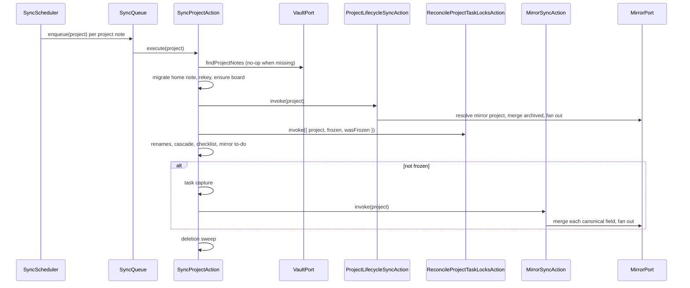

# ARCHITECTURE.md

The architecture document for this repository, following the
[architecture.md](https://architecture.md) schema — built so an agent (or a
new colleague) can comprehend the codebase from this file alone, and so this
repository's own architectural principles are visible in how it actually
works. Fill every section; update it in the same change that alters the
architecture it describes.

This repository is a community plugin for the host vault application, not a
service: it runs inside the vault, reads and writes the vault's notes, and
keeps the vault's project management mirrored onto a code host and a personal
task manager. The vault is the origin of truth; every remote is a mirror.

## 1. Project Structure

Module-first (ADR 004). The repository _is_ the module — the single bounded
context that mirrors the vault's project management onto external applications
— so its interior is the layers: `ui/` (driving adapters), `core/` (the
hexagon) and `infrastructure/` (driven adapters). OPM is one bounded context,
so `core` holds `application/`, `domain/` and `port/` directly, with no
`core/<component>/` wrapper. The architecture axis is carried by the folder;
the role axis by file-name suffixes (`Action`, `Port`, `Adapter`,
`DataTransferObject`, `Mapper`, `Parser`). The composition root is
`src/main.ts`, above the layers. Tests mirror the tree.

```
obsidian-project-management/
├── src/
│   ├── ui/              # driving adapters: settings/ (tab, schema,
│   │                    # secret-storage), sync/ (scheduler, queue)
│   ├── core/            # the module's hexagon
│   │   ├── application/ # use cases (actions/), DTOs (data/)
│   │   ├── domain/      # the neutral note arithmetic and the domain error
│   │   │                # (errors/)
│   │   └── port/        # the collaborator and factory ports
│   ├── infrastructure/  # driven adapters, one namespace per vendor:
│   │                    # vault/ (the single VaultAdapter + note codecs),
│   │                    # github/ (mirror adapter + transport),
│   │                    # todoist/ (mirror adapter + transport),
│   │                    # registry/ (the data.json-backed registry),
│   │                    # fake/ (in-memory conformance test double)
│   └── main.ts          # the composition root — wires every adapter and action
├── tests/               # mirrors src/
├── docs/                # developer manual — flows as sequence diagrams; ADRs
├── scripts/             # esbuild bundle, the provider-vocabulary + naming gates
├── eslint.config.js     # boundary enforcement lives here (eslint-plugin-boundaries)
├── manifest.json        # the plugin manifest
└── package.json
```

**Where the logic lives.** A use case is an action: a class with one
meaningful responsibility, named `*Action`. Adapters map raw provider payloads
onto canonical DTOs at the boundary; the core never sees a provider shape.
Pure calculations live in cohesive lowercase modules, grouped by subject
(`note`, `paths`, `affiliation`; the merge's `mergeField` and `sides`).
Delivery mechanics — the scheduler, the queue,
timers — belong to `ui/` and make no business decisions. Persistence is owned
by the registry adapter; nothing else touches `data.json`.

**The core.** `core/` is the module's hexagon. `application/` holds the use
cases (`actions/`), the application shapes (`data/`) and the connection-validation
service (`services/`); `domain/` holds the neutral note arithmetic, the merge
vocabulary (`mergeField` and its shapes — `Delta`, `MergeResult`,
`SideObservation`, `Baseline`, `OriginObservation`) and the domain error
(`errors/`); `port/` holds the ports and the canonical DTOs they carry
(`port/data/`). It names no provider. The three layers are gated separately —
`domain/` imports nothing outward, `application/` may use `domain/` and `port/`,
and `port/` may reference `domain/` only (its payloads live with the port) — so
a domain or port file that reaches outward fails the lint. `infrastructure/`
holds the driven adapters that implement those ports, one namespace per vendor.
The composition root wires them. The old provider halves, the pairwise verdict
and the legacy writers are deleted; the chain drives the vault-maintenance steps
(board-ensure, rename recovery, vault consistency, deletion sweep) directly,
documented in the developer manual.

**Growth rule.** Start flat; a folder appears when a second file of that role
or concept exists. A consumer folder appears when an action has exclusive
collaborators (`create-task-note/`, `sync-checklist/`). Modules split when
they outgrow grasp, not before.

## 2. High-Level System Diagram

The vault is the origin of truth. Project notes (a home note declaring a
non-empty `connections` map) and task/to-do notes are the system of record; the
code host (a repository plus a Projects v2 board) and the task manager are
mirrors the plugin keeps honest. A serialized sync pass reads the vault,
reconciles it against each mirror through one pure N-way merge, and writes the
winner back to whichever side is behind. The registry in `data.json` is the
memory that makes the merge possible: it holds each entity's identity and each
mirror's last-synced baseline (the core's
`coreBaselines`).

```
                       the vault (origin of truth)
              project notes · task notes · to-do notes
                              │
                  ┌───────────┴────────────┐
                  │      the sync pass      │
                  │  N-way merge → fan-out  │
                  └──────┬──────────┬───────┘
                         │          │
              ┌──────────┘          └──────────┐
              ▼                                ▼
      code host (mirror)              task manager (mirror)
    repo + Projects board             projects · sections · tasks
              ▲                                ▲
              └──────────────┬─────────────────┘
                             │ identity + baseline
                             ▼
                   registry in data.json
                        (the memory)
```

The pass is provider-neutral at its centre: the core reconciles canonical fields
across the origin and each connection's mirror adapter through the core's ports,
and the composition root supplies the concrete provider adapters. A provider's
name never appears in the core.

The per-project pass runs the same sequence every tick; the developer manual
carries a sequence diagram per path. The central flow:



## 3. Core Components

| Component             | Responsibility                                                                                                                                                                                                                                | Technology                   | Target         |
| --------------------- | --------------------------------------------------------------------------------------------------------------------------------------------------------------------------------------------------------------------------------------------- | ---------------------------- | -------------- |
| `src/main.ts`         | The composition root: plugin lifecycle, settings load, wiring, startup discovery and the project-capture pre-tick                                                                                                                             | host plugin API              | the vault      |
| `src/ui/`             | Driving side: `SyncScheduler` (delivery mechanics), `SyncQueue` (one serialized chain), the settings tab and schema, the SecretStorage-backed token store, and the vault-artifact seed action                                                 | host plugin API, `Component` | the vault      |
| `src/core/`           | The module's hexagon: the ports, the canonical DTOs, the pure `mergeField` N-way merge, every use case (`actions/`), and the neutral note arithmetic                                                                                          | TypeScript                   | in-process     |
| `src/infrastructure/` | Driven adapters, one namespace per vendor — the single vault adapter and note codecs, the GitHub and Todoist mirror adapters, the registry (`SyncStateAdapter` and the baseline store), and the in-memory conformance adapter | TypeScript, GraphQL, REST v1 | external tools |

### Ports & adapters

**The core's ports (`src/core/port/`).** The core owns these; each states the
core's need, never the tool's API it wraps. An adapter implements the port from
its own module; the composition root wires it.

- **The mirror port.** **`MirrorPort`** — the external tool as one collaborator,
  implemented by `CodeHostMirrorAdapter` and `TaskManagerMirrorAdapter`. The
  required surface is the project (read/create/rename, set and read archived
  state) and the task (`title`, `body`, `subtasks`, `completion`, `Status`,
  `label` — one generic write entry, `applyField`, dispatches a canonical field
  to the adapter's own representation; the completion fact is separate from the
  `Status` representation; `deleteTask` removes the mirror item). The
  genuinely optional surfaces are **optional methods**: `capture?`/
  `captureProjects?` (tracked tasks and the application-born projects a source
  enumerates), `fieldTime?` (trustworthy per-field timestamps), `fetchComplete?`
  (verified-complete fetch), `lockTask?`/`unlockTask?` (task locking)
  and the project-setup surface
  (`discoverProjects?`, `readProjectAddressing?`, `createProjectWithStatus?`,
  `adoptProject?`, `listProjects?`). A caller checks presence
  (`adapter.lockTask !== undefined`), never a capability string or a null-gated
  port slot; an adapter without a surface simply omits the method. The project,
  task, capture, timestamp, locking and setup surfaces were separate
  facet ports; the tool is one collaborator, so it is one port.
- **The vault port.** **`VaultPort`** — the vault as one collaborator: read a
  note by path, create/write/rename/trash a note, list a folder's notes and
  enumerate the project notes, subscribe to note change/delete/rename events;
  observe a task note's field as a canonical value plus its edit time (trusted
  by default), read the whole task, apply a canonical field write; read a
  project's declared connections and its task-note paths; observe and apply a
  project's archived state; adopt a captured project. Implementer:
  `VaultAdapter`. The origin, the project source, the lifecycle and the project
  capture were separate facet ports served by thin wrapper adapters; the vault is
  one collaborator, so it is one port and one adapter. The port is raw vault I/O
  — the task-capture adoption orchestration (choosing the renderer, writing the
  note, recording the mirror item) lives in `CaptureTasksAction`, never in the
  adapter.
- **The supporting ports.** `MirrorAdapterFactoryPort` (build a mirror adapter
  for an application + target; expose the capture sources) and
  `ProjectSetupFactoryPort` (reach a tool's project-setup surface, null for a
  tool without setup). These are the provider table's seams, not facets of a
  mirror adapter.

**The registry port (`src/core/port/RegistryPort.ts`).** The registry is one
collaborator, so it carries one provider-neutral seam: the tracked entities and
their mirror items, the note-path↔handle and mirror-project mappings, the
per-connection identity and port state, and the side baselines. Implementer:
`SyncStateAdapter`, which also composes the handle and mirror-project
resolution. Its records `EntityRecord`, `MirrorItem` and `PortState` live in
`src/core/port/data/`; the baselines stay in the `coreBaselines` store.
The baseline store, mirror handle, mirror project, identity store, tracked
entity and connection state were separate facet ports served by thin wrapper
adapters; one collaborator is one port.

A component that reaches around a port is a defect.

**Why the port count is what it is.** The ports come in two families. The
_mirror port_ — `MirrorPort` — is the adapter contract: the required project and
task surfaces every adapter carries, and the genuinely optional surfaces as
optional methods a caller presence-checks. The _collaborator ports_ — the
vault's `VaultPort` and the registry's `RegistryPort` — name only the methods
the core uses. One collaborator, one port; the provider table's factories are
seams beside them.

The API tokens are not settings and not a port: they live in Obsidian's
SecretStorage behind `SecretStorageAdapter` (`src/ui/settings/`), which the
composition root reads at adapter construction and the settings tab sets and
clears. `data.json` is secret-free.

### The multi-adapter core

The `core/` block is the shape of ADR 001. It consists of the port layer, the
canonical DTOs and the pure core.

- **Canonical fields.** `canonicalField.ts` holds the six canonical fields
  (`title`, `body`, `subtasks`, `completion`, `Status`, `label`). `MirrorPort`
  carries one generic write entry, `applyField`, and the completion fact is a
  separate canonical field from the `Status` representation. `canonicalField.ts`
  also carries `MergedField` (the canonical fields plus the project-level
  `archived` fact), so the archive reconciles through the
  same `mergeField` ladder as the task fields.
- **Canonical DTOs.** `CanonicalTask`, `CanonicalProject`,
  `ConnectionDataTransferObject`,
  `CanonicalFieldWrite`, `CapturedProject`, `AdoptedProject`, `ProjectSummary`,
  `ProjectCandidate`, `ProjectDiscovery`, `ProjectAddressing` and `PortState` —
  one canonical shape per concept, owned by
  the core. The boundary payloads live with the ports (`core/port/data/`); a
  merge action's private working shapes stay co-located with the action. The
  merge diffs canonical fields only.
- **The merge vocabulary** lives in `domain/` beside `mergeField`: `Delta`,
  `MergeResult`, `SideObservation`, `Baseline`, `OriginObservation`. A value
  the domain reads is a domain value; the ports and the application depend
  inward on it.
- **The pure N-way merge** (`mergeField`). Sides plus exactly one origin role;
  a delta per side against its own baseline; the ladder (decisive timestamp →
  completion over a stale open → origin tie-break); delete proof (a
  verified-complete fetch plus a synced baseline); the origin's absence as a
  delete delta; the origin's edit time trusted by default. No I/O, no clocks.
- **The provider table.** The composition root holds one plain `providers`
  table — a value mapping an application id to its mirror factory, capture
  factory, optional setup surface and token setting. It derives the
  mirror-adapter factory, the setup factory, the registered-application set and
  the token-settings list from that table, so adding an application is one entry
  and there is no validation framework, capability vocabulary or registration
  result. The provider's name is a value in its own module and in the
  composition root only.
- **The mirror-sync action** (`MirrorSyncAction`). Given a project, it reads each
  declared connection with its slug, builds the connection's mirror adapter
  through the factory (scoped by the connection's target), resolves the entity to
  that connection's own handle through `RegistryPort`, and runs the pure
  `mergeField` once per (entity, canonical value field). For each field it
  collects the origin side through `VaultPort` and each mirror's observation
  against its own baseline, fans the reconciled value out through the one generic
  write entry, writes the reconciled value back to the origin (or trashes the
  note on a delete), and advances the baseline of every side written or already
  matching — a skipped write advances too; a failed write advances nothing. A
  mirror write that throws is recorded among the field outcome's `failed` sides
  and fan-out continues to the remaining mirrors, so one failing connection
  never abandons the rest. The project source enumerates note paths, so a mirror
  side is keyed `mirror:<slug>` — disjoint from the origin side's `origin` key —
  while the origin keeps the note path as its handle. A connection whose entity
  has no resolved handle is materialized: the origin task is read through
  `VaultPort.readTask` (a note without a type label is not a task and is
  skipped), a placeholder handle is recorded through `RegistryPort` before the
  item is created through `MirrorPort.createTask`, the real handle replaces the
  placeholder, and the created mirror is reconciled in the same pass. A
  placeholder left by an interrupted pass is adopted by matching the mirror's
  task title rather than re-created. It names no provider.
- **The project lifecycle reconciliation** (`ProjectLifecycleSyncAction`). The
  project-level peer of the mirror-sync action: given a project it resolves each
  connection's mirror project through `RegistryPort`, onboarding a missing one
  via `MirrorPort.createProject`, then reads the origin's archived state through
  `VaultPort` and each mirror's through `MirrorPort`, runs the same pure
  `mergeField` ladder over the archived fact, and fans the reconciled freeze out
  to the origin and every capable mirror. Any side can start the freeze or the
  unfreeze; the reconciled freeze is the pass's `frozen` verdict, which gates the
  task-field pass. A mirror project whose name drifted is renamed through
  `MirrorPort.renameProject`. Its per-side baselines live in the same
  `coreBaselines` store under the `archived` field.
- **Task locking** (`MirrorPort.lockTask?`/`unlockTask?`) and
  `ReconcileProjectTaskLocksAction`. The core's need to close a task's
  conversation while its project is frozen and reopen it on unfreeze; the code
  host implements the methods and the task manager omits them. On a lifecycle
  transition the action enumerates the project's tracked mirror items through
  `RegistryPort`, skips connections whose adapter has no `lockTask`, skips the
  tasks whose vault status is the done lane, and locks the rest — or unlocks
  every tracked task on the unfreeze.
- **The project-capture surface** (`MirrorPort.captureProjects` +
  `CaptureProjectsAction`). A capture-capable adapter enumerates the
  application-born projects it can see, each carrying its name, its candidate
  connection targets and its creation clock. The core action adopts every
  project the vault does not already declare by name+connection — writing the
  home note with its connection envelope through `VaultAdapter` — so the first
  run adopts the whole back-catalogue. A project that links zero or several
  targets collects an error and is left for the next pass.
- **The task-capture surface** (`MirrorPort.capture` + `CaptureTasksAction`). For
  each declared connection, the core action reads the tasks the adapter's capture
  gate exposes — a code host exposes only type-labelled issues, a task manager
  exposes every task — and adopts every task the vault does not already hold as a
  task note. The whole listing is scanned each pass and the adopted mirror items
  are skipped, so the pass is idempotent without a cursor. The action routes by
  the connection's application — a code-host issue through
  `CreateTaskNoteAction`, a task-manager task rendered by
  `CapturedTaskNoteMapper` and written through `VaultPort` + `RegistryPort`.
- **The cutover.** `SyncProjectAction` drives the vault-maintenance steps
  (home-note migration, connection re-keying, board-ensure, rename recovery,
  vault consistency and the deletion sweep) and the core actions directly
  (`ProjectLifecycleSyncAction`,
  `ReconcileProjectTaskLocksAction`, `CaptureTasksAction`, `MirrorSyncAction`),
  every step wrapped so one failure logs and skips that step. It runs the
  lifecycle pass for the freeze verdict, the task-lock
  action on the freeze/unfreeze transition, the task capture for tracked tasks,
  and the mirror-sync pass for task-field reconciliation. The sweep enumerates
  the project's code-host connections directly, and the capture pre-tick runs the
  assembled core capture.
- **The infrastructure adapters.** `infrastructure/` is the driven-adapter
  block: one namespace per application (`infrastructure/<vendor>/`), each
  carrying the provider's own vocabulary, its transport boundary and its opaque
  target. A real mirror adapter is a new namespace beside the existing ones,
  wired by one composition-root table entry. `infrastructure/` imports `core/`
  only, and the provider-vocabulary gate keeps each namespace the sole home for
  its provider's name.
- **The GitHub mirror adapter** (`infrastructure/github/`) implements the
  `MirrorPort` surface for the code host: title and body as the issue, Status as
  the board card's lane, completion as the issue state (kept separate from the
  lane), subtasks as the sub-issue relation, label as the issue labels, and the
  project, setup, capture, complete-fetch, per-field-timestamp and task-lock
  surfaces. The composition root registers it under the application id
  `github`.
- **The Todoist mirror adapter** (`infrastructure/todoist/`) implements the
  `MirrorPort` surface for the task manager: title as the task content, body as
  the task description, Status as the project section, completion as the task's
  completed fact, subtasks as the parent relation, label as the task labels, and
  the project, capture, complete-fetch and per-field-timestamp surfaces; it omits
  the locking and setup methods. The composition root registers it
  under the application id `todoist`.
- **The registry adapter** (`infrastructure/registry/`) persists the core's
  memory in `data.json`: `SyncStateAdapter` (the `syncState` container and the
  `coreBaselines` store), with the pure codecs (`coreStorageRecord`,
  `syncStateSchema`, `loadDataSafely`) beside it.
- **The vault adapter** (`infrastructure/vault/`) implements `VaultPort`:
  `VaultAdapter`, with the pure note codecs (`connectionsOf`,
  `parseConnectionsBlock`, `renderConnectionsBlock`, the task-note codec) beside
  it. It is a structural peer of the application adapters, not a capability
  adapter.
- **The conformance adapter** (`infrastructure/fake/`) is an in-memory
  `MirrorPort` test double used by the core and adapter tests. It is not wired
  into the plugin.
- **Connection validation is open.** A connection is accepted when it names a
  registered application; the composition root supplies the registered set from
  the provider table's keys, so the accepted set is not a hardcoded union. An
  application that is not registered is rejected with a collected error.

## 4. Data Stores

- **The vault** — the system of record; markdown notes, not a database.
  Project notes live under `Projecten/<name>/` (or `Archief/` when archived)
  and declare their connections in a non-empty `connections` map; task
  notes under `taken/`; to-do notes under `todos/`. Identity is a
  vault-owned uuid held in the registry — filenames and frontmatter carry no
  machine id.
- **`data.json`** — the plugin's data file. It holds three containers:
  - **`syncState`** (schema version 3) — the per-mirror registry: `projects.<name>.entities`
    (uuid → note path), `projects.<name>.ports.<connectionSlug>.items.<handle>`
    (each mirror handle's entity id), the port bookkeeping
    (`provider`, `project`, `lastPoll`, `lanes`), per-connection identities
    (`projects.<name>.identities.<connectionSlug>`), and the
    per-project `fullScanPending` marker.
    Ports are keyed by the note's connection slug, so a project can hold two
    connections of the same tool; a slug rename re-keys the port in lockstep.
    Written only through `SyncStateAdapter`, behind a serialization mutex it
    shares with the settings save.
  - **`coreBaselines`** — the core's per-entity, per-field (a canonical field or
    `archived`), per-side `Baseline` (`value`, `completed`). A sibling of
    `syncState`, so a registry write cannot clobber it.
  - The settings keys (poll interval, done option, debounce, the six artifact
    paths and the status options) live at the root beside the containers.
- **`main.js`** — the built bundle; never authored.

No other persistent store. The mirrors hold copies, never authority.

## 5. External Integrations / APIs

- **Code host** — GraphQL for the project read (issues plus board cards), issue
  creation, the board operations, locking and sub-issue relations; REST for the
  label and state updates. The core
  consumes it through `MirrorPort` (project, task, capture, and the optional
  timestamp, complete-fetch, locking and setup methods). A fine-grained
  token, bearer.
- **Task manager** — REST v1 for projects, sections, tasks and labels. The core
  consumes it through `MirrorPort` (project, task, capture, and the optional
  timestamp and complete-fetch methods). An API token, bearer.
- **The host vault application** — the plugin API (vault read/write, events,
  `requestUrl`, settings and data). Behind `VaultPort` and the note codecs;
  only the adapter imports the host package.

There is no server of our own: every call goes through the host's `requestUrl`
over HTTPS.

## 6. Deployment & Infrastructure

- **Distribution** — a community plugin. `pnpm run build` bundles `src/` with
  esbuild to `main.js` (beside `manifest.json`), copied into a vault's
  `.obsidian/plugins/project-management/` and enabled under Community plugins.
- **CI/CD** — GitHub Actions: a dedicated release workflow (conventional
  commits → semver → bare-version tag carrying `manifest.json` and `main.js`,
  the shape Obsidian's plugin review requires) plus automatic-updates,
  inherited from the shared starters; there is no server-side deploy.
- **Monitoring/logging** — none remote. The plugin logs through the host
  console; a corrupt `data.json` is quarantined rather than silently reset.

## 7. Security Considerations

- **Credentials** — the code-host and task-manager tokens live in Obsidian's
  SecretStorage behind `SecretStorageAdapter`, never in `data.json` and never in
  the repository. The composition root reads them at adapter construction; the
  settings tab sets and clears them. `.env` files are ignored.
- **Transport** — every request is HTTPS through the host's `requestUrl`. The
  adapters are token-agnostic; the composition root injects the bearer header.
- **Least privilege** — the code-host token needs only Issues and Projects
  read/write; the task-manager token only its own data.
- **No runtime attack surface** — the plugin runs inside the vault's sandbox;
  no server, no inbound port.

## 8. Development & Testing Environment

- **Local setup** — the `devshell` submodule (`devshell-node`) via `.envrc` →
  `use flake ./devshell`; `direnv allow`, then `pnpm install`.
- **Build** — `pnpm run build` (esbuild bundle) or `pnpm run dev` (watch).
- **Testing** — Vitest (`pnpm test`, `pnpm run test:watch`); tests mirror
  `src/`.
- **Code quality** — TypeScript strict (`pnpm run typecheck`), ESLint flat
  config with prettier (`pnpm run lint`), prettier (`pnpm run format:check`).
- **Mechanical gates** (and what each makes impossible):
  - **`eslint-plugin-boundaries`** — the module dependency matrix. Elements
    are the `src/` layer folders — the three core layers (`core/domain`,
    `core/application`, `core/port`), `ui`, and `infrastructure` (with the two
    provider namespaces, `infrastructure/github/` and
    `infrastructure/todoist/`, as their own elements) — plus the src root (the
    composition root); inside the hexagon `core/domain` imports nothing,
    `core/application` may import the domain and the ports, and `core/port`
    may reference the domain only (its payloads live with the port);
    `infrastructure/` may import the core only; the provider namespaces never
    import each other; `ui/` reaches the core through the ports and
    infrastructure only for the storage key it shares with the registry
    adapter; the composition root wires everything. An unlisted import edge
    fails the lint, so the hexagon stays neutral and a domain or port file that
    imports outward cannot land. The seam is bite-tested
    (`tests/scripts/boundary-isolation.test.ts`): a domain→application, a
    domain→port and a port→application import each exit non-zero while
    application→domain exits zero.
  - **`boundaries/no-unknown-files`** and **`no-unknown-dependencies`** —
    every source file must belong to an element and every local import must
    resolve to one, so a new top-level module (including `core/` and
    `infrastructure/`) cannot slip in unclassified.
  - **`pnpm run lint:boundaries`** (`scripts/lint-boundaries.mjs`) — the
    provider-vocabulary gate. A provider name may appear only in the provider's
    own module (`infrastructure/<vendor>/`) and the composition root
    (`main.ts`); a capitalized provider name anywhere else fails. Inside the
    neutral architecture (`core/`, `infrastructure/`) the check is
    case-insensitive, so any provider name in the core fails. The gate is
    bite-tested (`tests/scripts/lint-boundaries.test.ts`): a deliberate core
    violation exits non-zero while the legitimate provider path exits zero, so a
    green gate on an empty tree cannot pass unnoticed.
  - **`pnpm run lint:naming`** (`scripts/lint-naming.mjs`) — the role-folder ↔
    suffix gate: a class in a role folder carries that folder's suffix
    (`core/port/` → `*Port`, `core/domain/errors/` → `*Error`,
    `core/application/actions/` → `*Action`). Bite-tested
    (`tests/scripts/lint-naming.test.ts`): a mis-suffixed file exits non-zero.
  - **`pnpm run typecheck`** — strict tsc; a class of runtime bugs becomes a
    compile error.
  - **`pnpm test`** — behavioral tests per module, including the mirror-sync
    action's integration tests.

## 9. Future Considerations / Roadmap

**Deliberate non-goals:**

- **No second provider wired.** The ports are provider-neutral, so a second
  code host or task manager is a matter of implementing the ports — but only
  GitHub and Todoist are wired today. The ports keep that door open; they do not
  justify a speculative adapter.
- **No conflict UI.** A multi-sided field conflict is resolved by rule, not by a
  person. The decision ladder's decisive-timestamp, completion-over-open and
  origin-authority rungs always produce a verdict, so no field is ever left for
  a human to arbitrate. A conflict dialog was excluded on purpose.
- **No server or database.** The registry is the plugin's own `data.json`; the
  vault is the system of record. There is no backend.
- **No permanent deletion.** A deleted note's echoes are removed from the
  mirrors, but the vault note itself is trashed, never destroyed.

**Known debt / open items:** None blocking. The vault-maintenance shell has been
retired — the chain drives its steps directly (ADR 003). The developer manual
records the remaining code-vs-brief discrepancy (the scheduler's injected
pre-tick capture).

The multi-adapter core (`core/` + `infrastructure/`) is wired end to end: the
GitHub and Todoist mirror adapters implement `MirrorPort`, the vault
origin adapters complete the origin round-trip, the mirror-sync action and the
core baseline store reconcile a whole project and persist its baselines, the
lifecycle pass reconciles the archived fact, the capture surfaces adopt
remote-born projects and tracked tasks, and the task-lock action handles a
frozen project. The runtime cutover is unconditional: the
chain builds the origin and the per-connection mirror adapters from the
project's connections and the stored secrets and drives the core actions
every pass.

## 10. Project Identification

Project Name: obsidian-project-management

Repository URL: https://github.com/99linesofcode/obsidian-project-management

Primary Contact/Team: Jordy Schreuders (99linesofcode)

Date of Last Update: 2026-10-12

## 11. Glossary / Acronyms

- **Vault** — the markdown note store the plugin runs inside; the origin of
  truth.
- **Mirror** — a copy of the vault's content on a remote (the code host or the
  task manager). A mirror is never authoritative.
- **Hub / entity** — one vault-owned thing (a task or to-do note) carrying a
  uuid; mirrors are its leaves.
- **Port** — a provider-neutral interface the core owns, stating the core's
  need; an adapter implements it.
- **Optional surface** — a surface not every adapter carries; it is an optional
  method on `MirrorPort`, absent from an adapter that lacks it, so a caller
  checks presence rather than gating on a declared capability.
- **Canonical field** — one of the six neutral field names (`title`, `body`,
  `subtasks`, `completion`, `Status`, `label`) the merge operates on.
- **Baseline** — the last-synced snapshot of a side; the third input to a
  side's delta. The core stores one per entity, field and side under
  `coreBaselines`.
- **Delta** — one side's change against its own baseline: a value, or a delete
  proven by a verified-complete fetch.
- **Decision ladder** — the ordered rules `mergeField` applies to a
  multi-sided conflict: decisive timestamp, then completion over a stale open,
  then origin authority.
- **Origin** — the vault side, distinguished by role: it supplies the tie-break,
  its edit time is trusted by default, and its absence is a delete.
- **Lane** — a board column / task-manager section.
- **Outward materialization** — creating a mirror for a vault-born task,
  placeholder-first: the mirror-sync action records a placeholder handle before
  it creates the missing item through the adapter, stamps the real handle over
  the placeholder, and reconciles it in the same pass; an interrupted pass
  adopts the created item instead of duplicating it.
- **Capture** — adopting a remote-born project or tracked task into the vault.
  Both enumerate the remote's items and adopt each the vault does not already
  hold — a project by name+connection, a task by its mirror handle — so the
  first run adopts the back-catalogue and a second pass is idempotent.

## 12. Conventions & Boundaries

The house standards this repository adheres to — stated here in full.
Enforced by `eslint-plugin-boundaries` (elements = the layer folders) and the
`lint:boundaries` vocabulary grep:

- **Folder structure**: module-first (ADR 004), lowercase; the repo is the
  module, its interior is `ui/` (driving), `core/` (hexagon) and
  `infrastructure/` (driven); a single-context module keeps `application/`,
  `domain/` and `port/` at `core`'s root, with no component wrapper. The
  folder locates the role; a consumer folder (`create-task-note/`) holds an
  action's exclusive collaborators.
- **File naming**: PascalCase classes with role suffixes (`*Action`,
  `*Adapter`, `*Port`, `*Mapper`, `*Parser`, `*DataTransferObject`);
  camelCase pure modules grouped by subject (`note.ts`, `paths.ts`,
  `affiliation.ts`), not one file per helper.
  Tests mirror the tree: `tests/<module>/…`.
- **Entry point**: `src/main.ts` — above the layers, never inside one; the
  composition root.
- **Dependency matrix**: `core/domain` imports nothing outward; `core/port`
  imports the domain only; `core/application` imports the domain and the ports;
  `infrastructure/` imports
  `core/` only; provider namespaces never import each other; `ui/` reaches the
  core through the ports and infrastructure only for the storage key it shares
  with the registry adapter; the composition root wires everything; no circular
  module dependencies.
- **Provider neutrality**: a provider name appears only in the provider's own
  module (`infrastructure/<vendor>/`) and the composition root; cross-cutting
  vocabulary is neutral (a provider name is a
  value argument, never a namespace key). The neutral architecture (`core/`,
  `infrastructure/`) is checked case-insensitively, so any provider name in the
  core fails.
- **Class vs function**: a class carries injected collaborators or behaviour —
  actions, adapters, a value object that enforces an invariant; a DTO is a
  `readonly` field holder, not a behaviour object; a pure
  codec (a mapper or parser of the same note text) is a function or a plain
  namespace object, never a stateful service. Pure transforms are grouped by
  subject into a lowercase module (`note.ts`, `paths.ts`, `affiliation.ts`,
  `checklist.ts`) — a value object where the behaviour belongs to a concept and
  enforces an invariant, a plain module where the transforms own nothing — not
  one file per helper; an interface consumed elsewhere gets its own file.
- **Canonical DTOs**: one canonical shape per domain concept, owned by the
  core; diff/merge logic operates on canonical fields only. A DTO mimicking a
  provider's structure is a provider shape, whatever its file name.
- **The vault wins**: a field changed on both sides resolves by origin
  authority; only a remote field time that provably postdates every local edit
  overrides it.
- **Base advances only after durable writes**: a side's baseline is stored after
  its write lands; a failed write advances nothing.
- **Documentation surfaces**: WHY comments at the change site; the developer
  manual (`docs/developer-manual.md`) updated when a flow changes.
