# obsidian-project-management — Developer Manual

This manual walks every path through the source. It is written against the code,
not against the design brief: where the two disagree, the code is described and
the disagreement is called out in
[Code-vs-brief discrepancies](#5-code-vs-brief-discrepancies).

The engine is the module's hexagon (`src/core/`) plus its driven adapters
(`src/infrastructure/`), wired by the composition root `src/main.ts`. The core
names no provider: it reconciles canonical fields across an origin and any
number of mirror sides through one pure N-way merge. A connection produces a
mirror side; the vault is the origin. The old chain — the two provider halves,
the pairwise verdict, the legacy writers — is gone; the chain
(`SyncProjectAction`) now drives the core actions and the vault-maintenance
steps (board-ensure, rename recovery, vault consistency, the deletion sweep)
directly, documented here as it exists.

---

## 1. Orientation

### What the plugin is

The vault is the origin of truth. A project is a folder under `Projecten/`
(or `Archief/` when archived) whose home note declares a non-empty
`connections` map — one entry per connection slug, `{ tool, project }`; a task
is a note under its `taken/` folder; a to-do is a task note under `taken/`
carrying the `type:todo` label. GitHub (a repository plus a Projects v2 board)
and Todoist are
**mirrors**: they hold copies of the vault's title, body, status and completion,
and the plugin keeps them honest. Identity is a vault-owned uuid held in the
registry (`data.json`'s `syncState` container); filenames and frontmatter carry
no machine id.

### The five core promises

1. **The vault is the origin of truth.** A note wins over a remote unless the
   remote provably changed more recently.
2. **No change is ever lost, and none is invented.** Every edit lands
   everywhere it should; nothing appears that nobody asked for.
3. **Deletion is deliberate and thorough.** Deleting a note removes its echoes
   everywhere. Deleting a twin on a remote never touches the note.
4. **Completion is sticky.** A completed task stays completed unless a person
   deliberately reopens it.
5. **Interruption is safe.** A stop at any moment recovers on the next start
   without losing or duplicating work.

### The cast

**The core (`src/core/`) names no provider.** It owns the canonical DTOs, the
one pure N-way merge, the mirror-sync action and the project lifecycle action.

- **The mirror port.** `MirrorPort` — the external tool as one collaborator.
  The required surface is the project (`readProject`, `createProject`,
  `renameProject`, `setArchived`, `archivedTime`) and the task (`readTasks`,
  `readTask`, `createTask`, `applyField`, `deleteTask`). The genuinely optional
  surfaces are optional
  methods: `capture?`/`captureProjects?`, `fieldTime?`, `fetchComplete?`,
  `lockTask?`/`unlockTask?`
  and the project-setup surface (`discoverProjects?`,
  `readProjectAddressing?`, `createProjectWithStatus?`, `adoptProject?`,
  `listProjects?`). A caller checks presence (`adapter.lockTask !== undefined`);
  an adapter without a surface omits the method.
- **The vault port.** `VaultPort` — the vault as one collaborator: read/write/
  enumerate/watch notes; observe/apply a task note's canonical field; read a
  project's declared connections and task-note paths; observe/apply a project's
  archived state; adopt a captured project. The origin, the project source, the
  lifecycle and the project capture are one collaborator, so they are one port.
  The port is raw vault I/O: the task-capture adoption orchestration lives in
  `CaptureTasksAction`.
- **The supporting ports.** `MirrorAdapterFactoryPort` (the mirror factory) and
  `ProjectSetupFactoryPort` (reach a tool's project-setup surface).
- **The registry port.** `RegistryPort` — the tracked entities and their mirror
  items, the note-path↔handle and mirror-project mappings, the per-connection
  identity and port state, and the side baselines. The vault is one `VaultPort`
  and the registry is one `RegistryPort`: one collaborator, one port.
- **The canonical fields.** `canonicalField.ts` holds the six canonical fields
  (`title`, `body`, `subtasks`, `completion`, `Status`, `label`) and `MergedField`
  (the canonical fields plus the project-level `archived` fact), so the archive
  reconciles through the same `mergeField` ladder as the task fields.
- **The canonical DTOs.** `CanonicalTask`, `CanonicalProject`, `Baseline`,
  `SideObservation`, `OriginObservation`, `Delta`, `MergeResult`,
  `ConnectionDataTransferObject`,
  `CanonicalFieldWrite`, `CapturedProject`, `AdoptedProject`, `ProjectSummary`,
  `ProjectCandidate`, `ProjectDiscovery`, `ProjectAddressing` and `PortState`.
  The boundary payloads live with the
  ports (`core/port/data/`); a merge action's private working shapes stay
  co-located with the action.
- **The pure merge.** `mergeField(origin, mirrors)` — no I/O, no clock, no
  randomness (see [§3](#3-the-decision-ladder)).
- **The provider table.** The composition root holds one plain `providers`
  table mapping an application id to its mirror factory, capture factory,
  optional setup surface and token setting; it derives the mirror-adapter
  factory, the setup factory, the registered-application set and the
  token-settings list from it. No validation framework, capability vocabulary or
  registration result.
- **The actions.** `MirrorSyncAction` (the whole-project task pass),
  `ProjectLifecycleSyncAction` (the project-level peer), `CaptureProjectsAction`,
  `CaptureTasksAction` and `ReconcileProjectTaskLocksAction`.

**The driven adapters (`src/infrastructure/`) implement those ports, one
namespace per application.**

- **Vault.** `VaultAdapter` (the `VaultPort`), with the pure note codecs
  (`connectionsOf`, `parseConnectionsBlock`, `renderConnectionsBlock`,
  `taskNoteCodec`) beside it.
- **GitHub.** `CodeHostMirrorAdapter` (the `MirrorPort`, including the setup
  and locking surfaces), `CodeHostTarget` and `CodeHostTransport`.
- **Todoist.** `TaskManagerMirrorAdapter` (the `MirrorPort`, without the setup
  and locking methods), `TaskManagerTarget`,
  `TaskManagerTransport` and `TodoistTransport`.
- **Registry.** `SyncStateAdapter` (`RegistryPort`; the `syncState` container
  and the `coreBaselines` store), with the pure codecs (`coreStorageRecord`,
  `syncStateSchema`, `loadDataSafely`) beside it.
- **Conformance.** `ConformanceMirrorAdapter` — an in-memory `MirrorPort` test
  double, used by the core and adapter tests.

**The driving side and the pass.**

- **`SyncScheduler`** — delivery mechanics only. A poll interval and vault
  change/delete/rename events enqueue project names; renames bypass the
  debounce. Before each tick it runs the injected project capture, so a project
  born on a remote is captured before the per-project chain reads it. It makes
  no business decisions.
- **`SyncQueue`** — one serialized promise chain for the whole plugin. Runs one
  project at a time, coalesces duplicates, swallows a failed run so the queue
  never poisons.
- **`SyncProjectAction`** — the chain. One work item (a project folder name) and
  one entry point; it drives the vault-maintenance steps and the core actions
  (`ProjectLifecycleSyncAction`,
  `ReconcileProjectTaskLocksAction`, `CaptureTasksAction`, `MirrorSyncAction`) in
  order, wrapping every step so one failure logs and skips that step.
- **`main.ts`** — the composition root. `composePlugin` builds the provider
  table, the vault adapter, the mirror-adapter factory, the setup adapter and
  the maintenance actions; `composeCoreActions` eagerly builds the core actions
  and their infrastructure peers.
- **`SyncStateAdapter`** — the registry (see [§2.9](#29-the-registry)).
- **`SeedVaultArtifactsAction`** — seeds the six vault-owned artifacts (three
  note templates, three Bases files) create-if-missing, on init and on demand
  from the settings tab.
- **The pass's actions.** `MigrateLabelsAction`, `DetectNoteRenamesAction`,
  `SweepDeletedNotesAction`, `HandleDeletedNoteAction`,
  `MigrateProjectHomeNoteAction`, `RekeyRenamedConnectionsAction`,
  `DiscoverProjectsAction`, `AttachProjectAction`, `ResolveProjectBoardAction`,
  `EnsureProjectBoardAction`, `CompleteTaskCascadeAction`, `SyncChecklistAction`,
  `MirrorTodoStatusAction` and `CreateTaskNoteAction`.

### The provider table

The composition root holds one plain `providers` table — a value mapping an
application id to its mirror factory, capture factory, optional setup surface
and token setting. No descriptor, no validation, no registration result: the
provider's name is a value in its own module and in the composition root only.

`main.ts` derives the mirror-adapter factory, the setup factory, the
registered-application set (`new Set(Object.keys(providers))`, the set a
connection's tool must name to validate) and the token-settings list
(`Object.values(providers).map((provider) => provider.token)`, which the
settings tab renders) from that table. Adding an application is one table entry;
the kernel is not edited.

---

## 2. Sequence diagrams

Each diagram names the real classes and follows the actual call graph. A
one-paragraph summary precedes each.

### 2.1 The pass

On load, `SyncScheduler.tick` first runs the injected project capture
(`CaptureProjectsAction`, [§2.6](#26-project-capture)), then enumerates the
vault's project notes and enqueues each project name; `SyncQueue` runs them one
at a time. `SyncProjectAction.execute` re-resolves the project (a stale work
item no-ops), then drives every step in order. It first migrates each note's
legacy `type` scalar into a `type:` label (`MigrateLabelsAction`), then migrates
a legacy home note, re-keys a renamed connection, and ensures a code-host board
for each active github connection; the core actions
reconcile the lifecycle into one freeze verdict, and
reconcile task locks on the transition; then it recovers renames, runs the
vault-consistency step, and — when not frozen — runs the task capture and the
task-field pass, finally sweeping deletions. Every step failure logs and skips
that step without blocking the others.

#### 2.1a Startup and the pre-tick capture

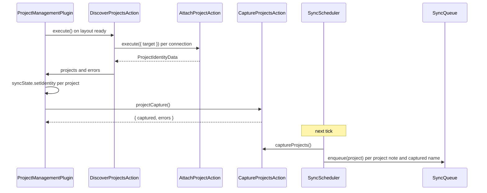

#### 2.1b The chain order

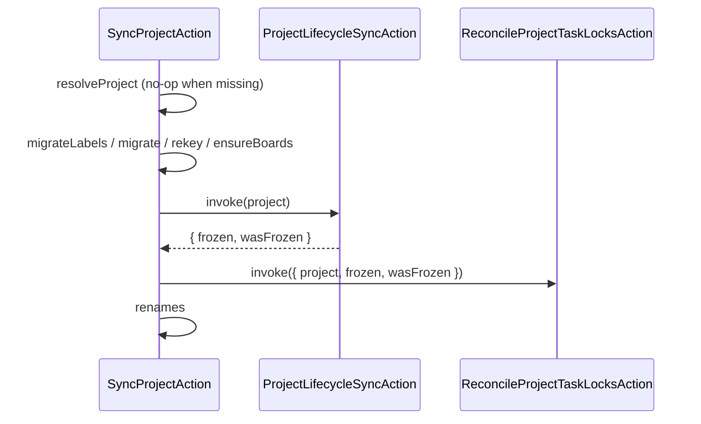

#### 2.1c The core actions and the sweep

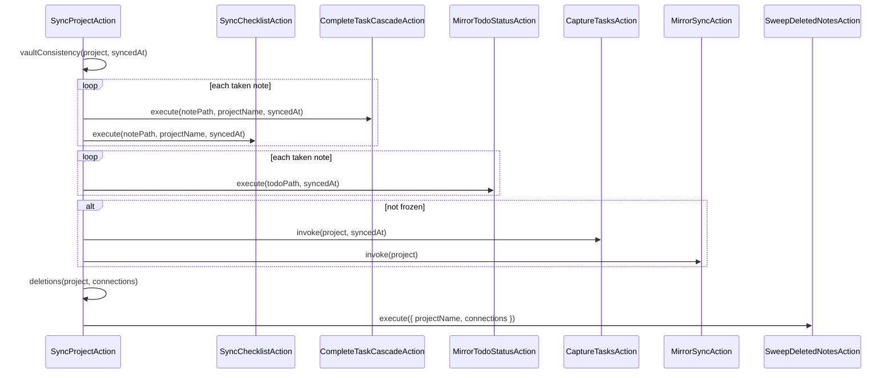

`SyncProjectAction` holds one instance of each core action, built by the
composition root. The lifecycle action returns
`{ frozen, wasFrozen }`; when it throws, `SyncProjectAction` falls back to
`note.archivedAt`.

### 2.2 The N-way merge (`mergeField`)

`mergeField` is the whole decision: it derives one `Delta` per side against that
side's own `Baseline`, then applies the ladder. It is pure — no I/O, no clock,
no randomness. Its inputs are `SideObservation`s (one origin, N mirrors); its
output is a `MergeResult` carrying the outcome, the winning value, the rung, the
deltas and the superseded deltas.

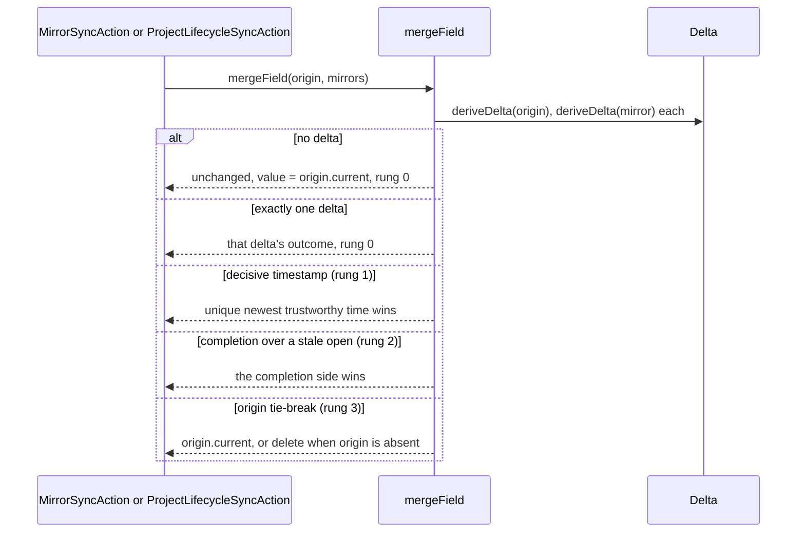

Delta derivation (see [§3](#3-the-decision-ladder) for the rules): an origin
whose `current` is `null` with a baseline is a **delete** delta; a mirror's
absence is a delete only when it has a baseline **and** its adapter exposes
`fetchComplete` and it returned true.

### 2.3 The mirror-sync action (`MirrorSyncAction`)

`MirrorSyncAction` names no provider. Given a project, it reads the declared
connections and the project's task-note paths, builds one mirror adapter per
connection through `MirrorAdapterFactoryPort`, resolves each note to that
connection's own handle through `RegistryPort`, and runs the pure `mergeField`
once per (note, canonical field) over the six merged fields — `title`, `body`,
`subtasks`, `completion`, `Status`, `label`. For each field it observes each
mirror against its own baseline, calls `mergeField`, fans the reconciled value
out through the one generic write entry, applies the same value to the origin,
and persists each advanced side's `Baseline`. A mirror write that throws is
recorded among the field outcome's `failed` sides and fan-out continues to the
remaining mirrors, so one failing connection never abandons the rest.

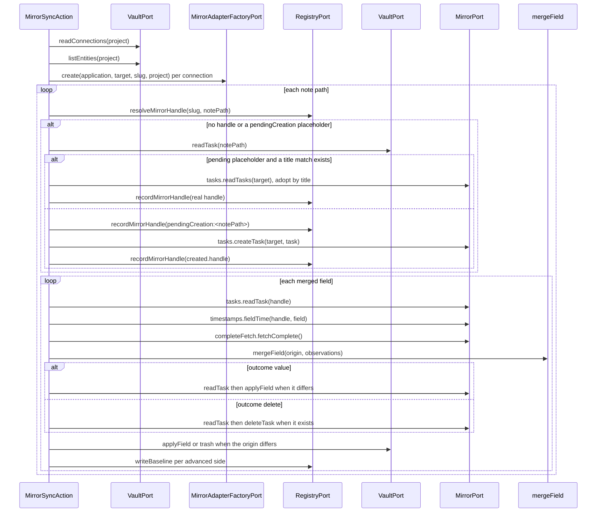

The side key is `mirror:<slug>` (`mirrorSideKey`), disjoint from the origin's
`origin` key, so a connection slug of `origin` cannot collide. Two connections
to the same application stay distinct sides. A connection whose entity has no
resolved handle is **materialized**: the origin task is read through
`VaultPort.readTask` (a note without a `type` is not a task and is skipped), a
placeholder handle is recorded through `RegistryPort` before the item is
created through `MirrorPort.createTask`, the real handle replaces the
placeholder, and the created mirror is reconciled in the same pass. A
placeholder left by an interrupted pass is **adopted** by matching the mirror's
task title rather than re-created, so a failed record never duplicates the item.
A side is **advanced** when it was written or already matched; a skipped write
still advances (the repair path for a widened value); a failed write advances
nothing.

### 2.4 The project lifecycle pass (`ProjectLifecycleSyncAction`)

`ProjectLifecycleSyncAction` is the project-level peer of the mirror-sync action.
Given a project it scopes the mirrors, resolves each connection's mirror project
through `RegistryPort` — onboarding a missing one by `MirrorPort.createProject`
and recording the returned handle, so a newly-connected project is onboarded in
the same pass — renames a mirror project whose name drifted from the vault
project through `MirrorPort.renameProject`, reads the origin's archived state
through `VaultPort`, runs the same `mergeField` ladder over the
archived fact, and fans the reconciled freeze out to the origin and every
capable mirror. Any side can start the freeze or the unfreeze; the reconciled
freeze is the pass's `frozen` verdict, which gates the task-field pass. Its
per-side baselines live under the `archived` field in the same baseline store.

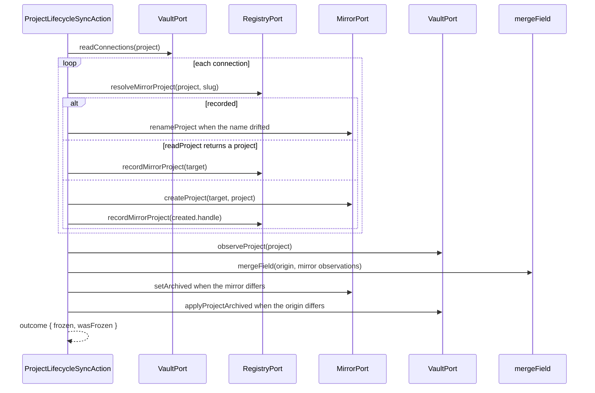

`wasFrozen` is `pass.origin.baseline?.value === 'true'`; `frozen` is
`result.value === 'true'`. A mirror that exposes no archive time returns `null`
from `archivedTime`, so the ladder falls through to the vault tie-break.

### 2.6 Project capture (`CaptureProjectsAction`)

A capture-capable adapter enumerates the application-born projects it can see
(`MirrorPort.captureProjects`), each carrying its name, its candidate
connection targets and its creation clock. The action adopts every project the
vault does not already declare by name+connection — writing the home note with
its connection envelope through `VaultPort` — so the first run against an
account adopts the whole back-catalogue. There is no cursor and no stored
timestamp: every run re-enumerates the remote and skips what the vault already
declares, so the pass is idempotent. A project that links zero or several
targets collects an error and is left for the next pass; an adoption failure on
one project is collected and the rest still adopt.

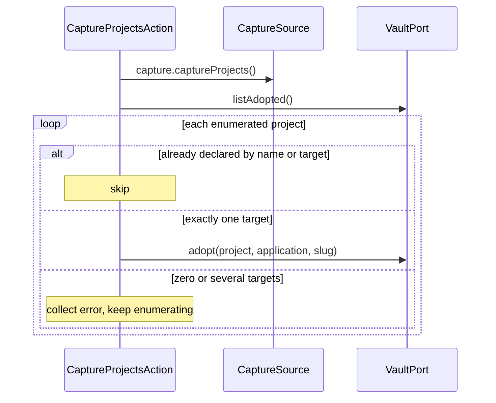

### 2.7 Task capture (`CaptureTasksAction`)

For each declared connection whose adapter carries `capture`, the core action
reads the tracked tasks the adapter can see (`MirrorPort.capture`) — the issues
carrying a `type:` label — and adopts every task the vault does not already hold
as a task note. A connection whose adapter omits `capture` is skipped. The whole
listing is scanned each pass and the adopted mirror
items are skipped, so the pass is idempotent without a cursor. The action
routes by the connection's application: a code-host issue through
`CreateTaskNoteAction`, a task-manager task rendered by `CapturedTaskNoteMapper`
and written through `VaultPort` + `RegistryPort`. A connection whose
listing or adoption fails is collected and never stops the later connections.

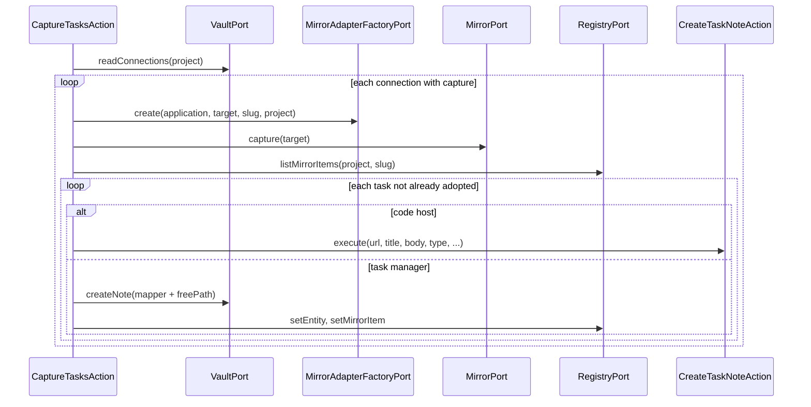

### 2.8 Task locks

`ReconcileProjectTaskLocksAction` runs only on a freeze/unfreeze transition
(`frozen !== wasFrozen`). For each connection whose adapter declares
`task-locking`, it enumerates the project's tracked mirror items through
`RegistryPort`, skips the tasks whose vault status is the done lane, and
locks the rest — or unlocks every tracked task on the unfreeze.

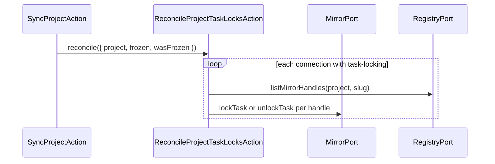

### 2.9 The registry

`SyncStateAdapter` is the single writer of the `syncState` container. Every port
method funnels through a promise-chain mutex, so a command racing a sync pass
cannot interleave a load-modify-save. The first load reads the `syncState`
container, builds the in-memory indexes, and caches it. Ports are keyed by the
note's connection slug (not the provider name), so a project can hold two
connections of the same tool; discovery re-keys a renamed connection's port in
lockstep (`rekeyPortState`). Identities are keyed per connection
(`projects.<name>.identities.<connectionSlug>`), so two code-host connections
address their own repositories and boards. Every write persists through a
fresh read of the `data.json` root (so settings keys survive) after asking for a
throttled rolling backup. A container whose version is NEWER than this plugin's
is loaded read-only: reads serve it, but every mutating port method throws
("registry written by a newer plugin version — refusing to mutate"). A corrupt
`data.json` is quarantined by `loadDataSafely` before the adapter ever sees it.
The settings save shares this one chain through `mutateRoot`.

The core's own memory lives in a sibling top-level key, written through the
same storage. The baselines are folded into `SyncStateAdapter`:

- **`coreBaselines`** (`SyncStateAdapter`) — per entity, per `MergedField` (a
  canonical field or `archived`), per side, a `Baseline` (`value`,
  `completed`).

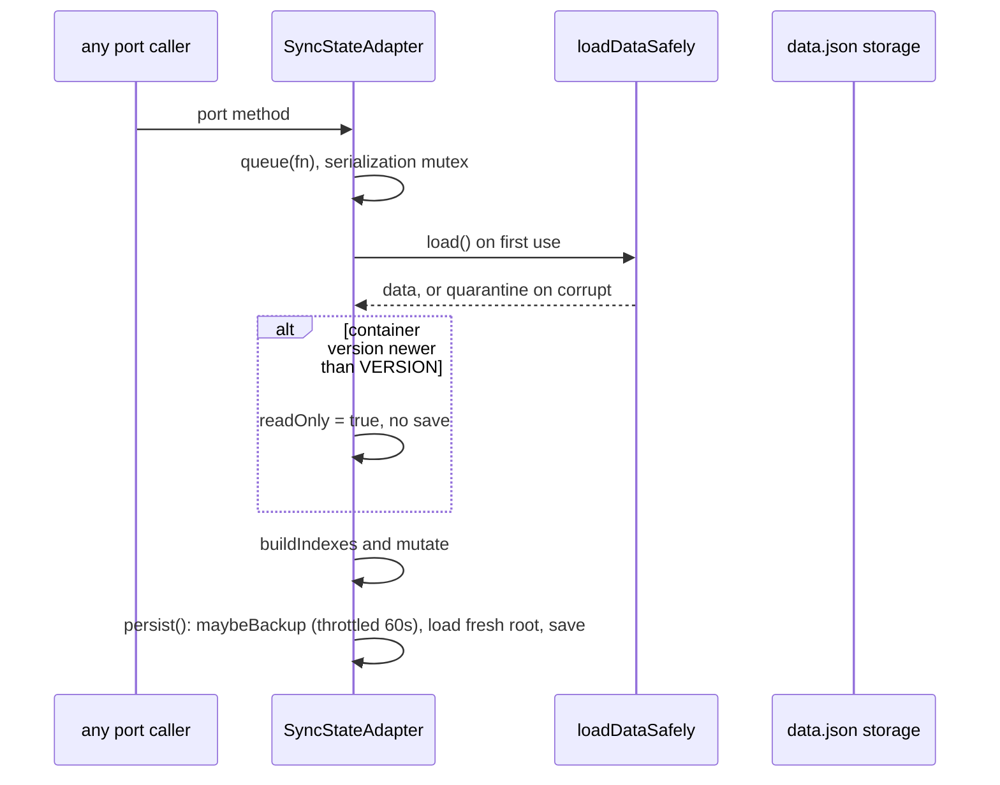

### 2.10 Settings save

Settings and the registry share `data.json` but are split so a settings save can
never revert the registry. At onload, `settingsFromData` copies the root and
deletes the `syncState` key, so the in-memory settings never carry a registry
snapshot. `saveSettings` calls `SyncStateAdapter.mutateRoot`, which runs on the
SAME promise chain as every registry write: it reads a fresh root, merges the
settings into it (`mergeSettingsIntoData` skips `syncState`), and persists.

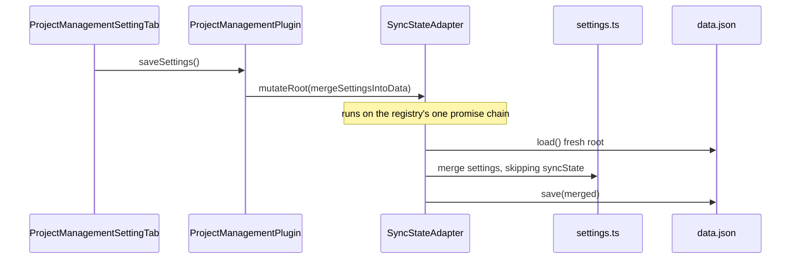

### 2.11 Provider wiring

The composition root holds one plain `providers` table and derives its seams
from it. `mirrorAdapterFactory.create` looks the application id up in the table
and builds the mirror through that entry's factory; `buildCaptureSources`
iterates the table and keeps the entries whose capture adapter carries
`captureProjects`; the setup factory resolves `setupFor(application)` the same
way. No validation, no registration result.

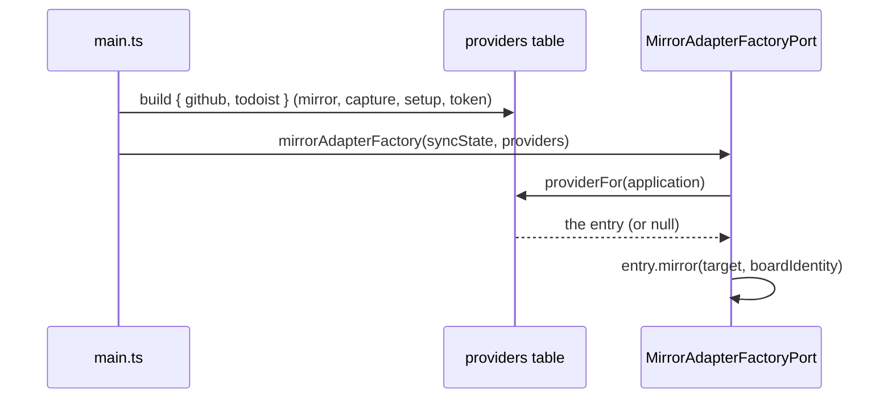

### 2.12 Vault consistency

The chain's vault-consistency step keeps the markdown checklist and the vault
to-do notes in step. `SyncChecklistAction` promotes an unlinked line to a new
to-do note, relinks a short or wrong-folder link, renames a drifted to-do,
follows the checkbox, and trashes a to-do whose line was removed.
`MirrorTodoStatusAction` runs the other direction: a to-do note's status updates
its parent task's checkbox. Both settle, so a second pass writes nothing.

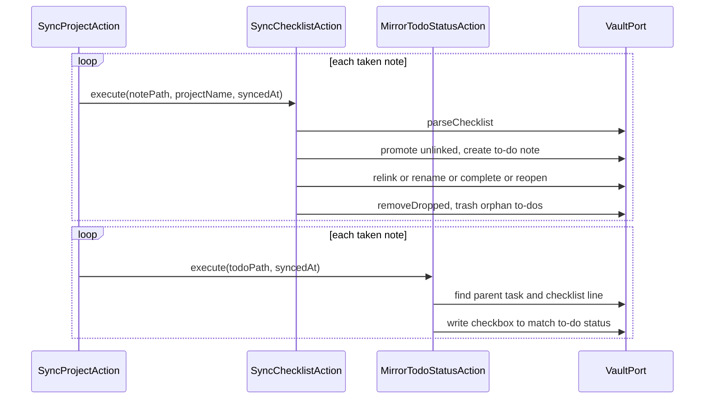

### 2.13 Completion and the cascade

Done is one fact with one stamp. The invariant is `status === doneLane` if and
only if `completedAt !== null`. `CompleteTaskCascadeAction` is the vault-side
projection: when a task's status is the done lane it checks the task note's own
checklist lines, completes every still-open to-do the task owns, and checks the
task's own line in a parent slice's checklist. Reopen is asymmetric: the parent
slice line mirrors the status in both directions, but the to-dos are never
auto-reopened. The core's `completion` field carries the same fact to the
mirrors through `MirrorSyncAction`.

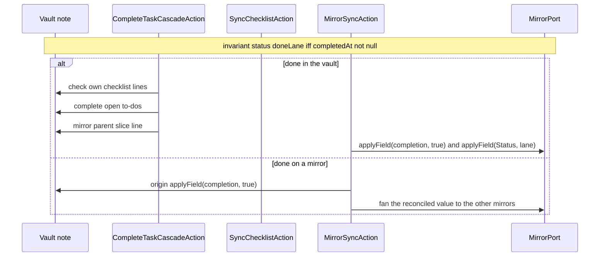

### 2.14 Deletion propagation (factory-backed)

A deleted note is swept by `SweepDeletedNotesAction`, which enumerates the
project's entities and, for each whose note is gone, calls
`HandleDeletedNoteAction`. That action finds the registry record by note path,
resolves the connection's mirror item through `RegistryPort`, builds the
connection's adapter through `MirrorAdapterFactoryPort`, and calls
`MirrorPort.deleteTask` (the GitHub adapter deletes the board card). When
the stored base lane is not the done lane it then applies
`completion = true` through the generic write entry, which closes the issue.
Finally it evicts the entity, dropping its remaining mirror items. Deletion
starts in the vault; a remote deletion is never honored as a deletion of record.

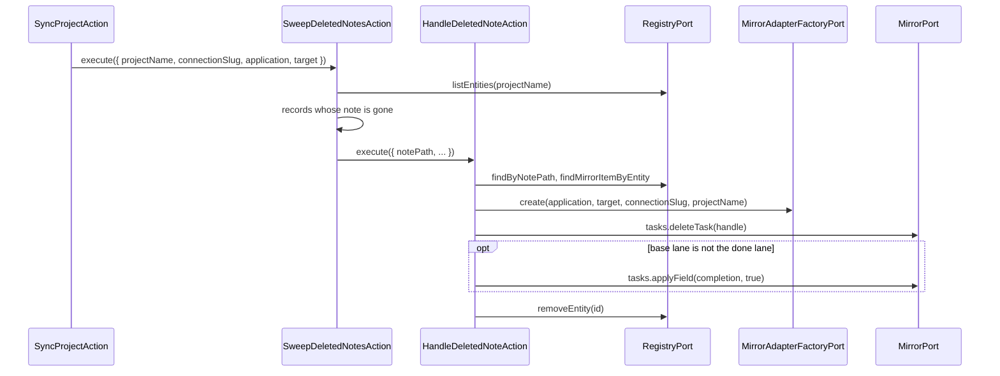

The reverse case: a twin deleted by hand whose note survives is not a deletion
of the note. The vault wins, and the projection recreates the twin in the same
tick.

### 2.15 Rename survival

A live rename event bypasses the debounce and enqueues the project immediately,
but the recovery itself is the same as an offline rename:
`DetectNoteRenamesAction` lists the current notes and the records, groups the
untracked notes by a recovery stem (the filename stem with a legacy ordinal
prefix stripped and lowercased, via `normalizedStem`), and moves each vanished
record's `notePath` to the same-stem note. The uuid and the mirrors are
untouched.

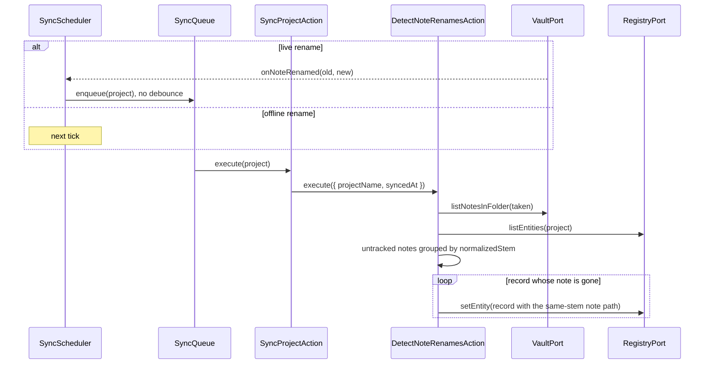

### 2.16 Discovery, attach and board-ensure (the setup surface)

At `onLayoutReady`, `DiscoverProjectsAction` enumerates the vault's project
notes and attaches each setup-capable connection through `AttachProjectAction`,
which consults `ResolveProjectBoardAction` — the one home for the
create/adopt/ambiguous decision — to resolve the repository and its boards and
pick one (or none), then uses `readProjectAddressing` to resolve
the Status field and its options. A board that does not exist yet yields an
identity with an empty `projectHandle`, which `EnsureProjectBoardAction`
resolves later on the chain: it adopts a linked board, prefers the one titled
with the repo name, creates one (with a Status field) when none exists, and
adopts an unlinked same-name viewer board (the orphan of an interrupted
creation) rather than duplicating it. The identities are persisted so later
board operations can resolve them.

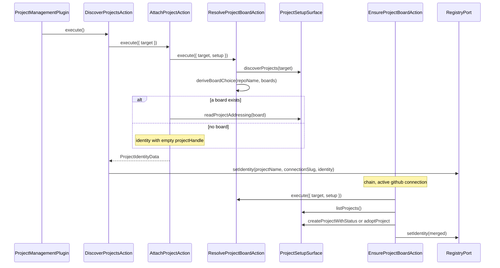

---

## 3. The decision ladder

`mergeField(origin, mirrors)` is pure: no I/O, no clock, no randomness. It runs
in two stages.

**Stage 1 — attribution (`deriveDelta`).** For each side, compare the side's
current canonical value with its own baseline:

- current equals baseline → no delta;
- current differs (or there is no baseline) → a `value` delta carrying the
  current value, the side's field time and whether it is completed;
- current is `null` with a baseline → a `delete` delta. The origin's absence is
  always a delete; a mirror's absence is a delete only when its adapter declares
  `complete-fetch` and `fetchComplete()` returned true (a verified-complete
  fetch), so an adapter that cannot prove a full listing never deletes on
  absence.

**Stage 2 — resolution.** With the deltas collected:

1. **No delta.** `unchanged`; the value is the origin's current value.
2. **Exactly one delta.** That delta wins at rung 0; its kind is the outcome.
3. **Rung 1 — decisive timestamp.** Consider only trustworthy deltas with a
   non-null time. The newest must be unique, and every other delta must be
   trustworthy, have a time, and be strictly older. Then the newest wins. A
   non-trustworthy or timeless side blocks the rung, so the ladder falls
   through.
4. **Rung 2 — completion over a stale open.** Among value deltas, if at least
   one is a completion and at least one is an open, there are no deletes, the
   origin is not itself an open delta, and all completions carry the same value,
   the completion wins. (The origin's own open state blocks the rung, so a
   completion never overrides a deliberate vault reopen.)
5. **Rung 3 — origin authority.** The origin wins. If the origin's current
   value is `null`, the outcome is `delete`; otherwise it is `value` with the
   origin's value. This is the fallback for every remaining multi-sided
   conflict, including both-done `Status` conflicts (which differ only in lane
   cosmetics).

The invariant: after `mergeField`, every multi-sided conflict has a winner, so
no field is left undecided. The collapsed outcome drives the fan-out; the
origin's absence is a delete delta, and the origin's edit time is trusted by
default (the origin side sets `timestampTrustworthy: true`).

The reopen veto the old pairwise verdict applied on the pull path is subsumed:
the GitHub adapter keeps the completion fact separate from the `Status`
representation, and `completion` is merged as its own field, so a stale board
lane can no longer revert a completion.

---

## 4. Invariants cheat-sheet

- **Base advances only after durable writes.** `MirrorSyncAction` records a
  side as advanced only after its write resolves (or when it already matched),
  then writes that side's `Baseline`. A
  failed write is recorded in `failed` and advances nothing. A skipped write
  still advances: the side already matched the reconciled value, which is the
  repair path for a widened value.
- **A fact from one mirror never moves another's base.** Each side is compared
  against its own baseline; the reconciled value is fanned out to every capable
  mirror, and each side's baseline advances independently.
- **A mirror's absence is a delete only with a verified-complete fetch.** An
  adapter without `complete-fetch` (or whose `fetchComplete()` is false) never
  yields a delete from absence, so a partial listing cannot delete a mirror
  item.
- **The origin's absence is a delete.** The origin side always has
  `completeFetch: true`; a missing origin task with a baseline is a delete
  delta, and rung 3 produces `delete` when the origin is absent.
- **The origin's edit time is trusted by default.** `originSideObservation`
  sets `timestampTrustworthy` from the origin observation, which the vault
  adapters set to `true`.
- **Completion is sticky.** Rung 2 lets a completion beat a stale open, and
  rung 3 falls back to the origin, so an open origin is never overridden by a
  mirror's completion; a deliberate vault reopen holds.
- **The completion fact is separate from the Status representation.** The
  canonical `completion` field carries done-ness; `Status` carries the lane. A
  both-done conflict resolves by origin authority without collapsing the two.
- **Flatten before delete.** A slice twin is retired by moving
  every direct child to the top level, awaiting the moves, and only then
  deleting the twin; a failed flatten aborts before the delete and retries next
  tick.
- **Registry writes are serialized.** Every `SyncStateAdapter` port method and
  the settings save run on one promise chain, so a load-modify-save can never
  interleave. A container written by a newer plugin version is read-only.
- **A quiet tick writes nothing.** A merged field or task side that already
  matches is advanced without a remote write.
- **The `coreBaselines` key is a sibling of `syncState`.**
  The core's memory is separate from the registry's, so a write
  on one cannot clobber the other.

---

## 5. Code-vs-brief discrepancies

These are places where the code settled something the original design brief left
open. The code is documented above; the brief's version is recorded here.

1. **The scheduler's pre-tick capture is injected, not owned.** `SyncScheduler`
   invokes an optional `captureProjects` callback and enqueues its returned
   names; `main.ts` wires that callback to `projectCapture()`. The scheduler
   itself makes no decision about what the capture does.

---

## 6. Where to start reading

The tree is module-first (ADR 004): the repo is the module, its interior is the
layers, and each layer owns one surface of the system.

- The wiring and construction order: `src/main.ts` (`onload`, `composePlugin`,
  `composeCoreActions`, `mirrorAdapterFactory`).
- The core: `src/core/` — the pure engine (`mergeField`, `MirrorSyncAction`,
  `ProjectLifecycleSyncAction`), the
  ports and their payloads under `src/core/port/` (`port/data/`), the
  application shapes under `src/core/application/data/`, and every use
  case under `src/core/application/actions/`.
- The use cases folded in from the former concept modules:
  `src/core/application/actions/` holds the discovery/attach/board actions
  (former `projects/`), the chain (`SyncProjectAction`, `DetectNoteRenamesAction`,
  `SweepDeletedNotesAction`, `HandleDeletedNoteAction`), the cascade
  (`CompleteTaskCascadeAction`) and the checklist/to-do actions.
- The capture and lifecycle actions:
  `src/core/application/actions/CaptureProjectsAction.ts`,
  `CaptureTasksAction.ts`, `ReconcileProjectTaskLocksAction.ts`.
- The neutral note arithmetic and the merge vocabulary: `src/core/domain/`
  (the note transforms `note`, the project-path arithmetic `paths`, the
  affiliation helpers `affiliation`, `checklist`, `ToDoNoteParser`, and
  `mergeField` with its `Delta`/`MergeResult`/`SideObservation`/`Baseline`/
  `OriginObservation` shapes).
- The driven adapters: `src/infrastructure/` (`vault/`, `github/`, `todoist/`,
  `registry/`, `fake/`). Only `infrastructure/vault/VaultAdapter.ts` touches the
  Obsidian API; the neutral note arithmetic is in the domain.
- The registry: `src/infrastructure/registry/` (`SyncStateAdapter`,
  `syncStateSchema`, `loadDataSafely`).
- The note codecs live with their consumers:
  `src/core/application/actions/create-task-note/TaskNoteMapper.ts` beside
  `CreateTaskNoteAction` and
  `src/core/application/actions/capture-tasks/CapturedTaskNoteMapper.ts` beside
  `CaptureTasksAction`.
- The driving side: `src/ui/` (`SyncScheduler`, `SyncQueue`, the settings
  module).
